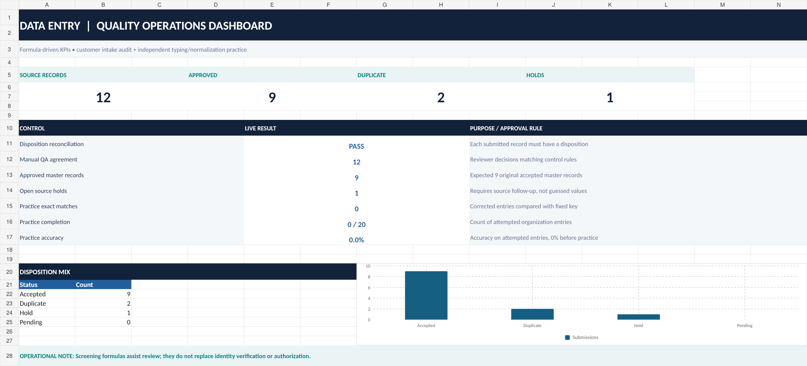

# 📋 Customer Data Entry, Verification & Quality Control

### Microsoft Excel | Data Cleaning | Customer Records | Data Validation | Quality Assurance

**Professional Data Operations Portfolio — Project 01**

**Created by:** Jamie Christian II


---

## 📖 Project Overview

This project demonstrates a structured customer data entry, verification, and quality-control workflow using Microsoft Excel, CSV datasets, and professional business documentation.

The scenario involves a fictional customer onboarding team responsible for transforming inconsistent source records into accurate, standardized, and traceable customer information.

The project includes an original 12-record exercise and an expanded 120-record processing demonstration.

### 🎯 Business Objectives

- Improve the accuracy and consistency of customer information.
- Detect missing, invalid, and duplicate records.
- Standardize customer names, contact information, dates, and regions.
- Apply documented rules before approving records.
- Maintain traceable records of corrections and exceptions.
- Prepare reliable customer master datasets.
- Demonstrate professional Excel reporting and quality control.
- Produce business-ready documentation and mail merge examples.

---

## 🖥️ Excel Quality Control Dashboard

The Excel workbook includes a quality-control demonstration supported by a visual dashboard.



**Featured workbook:**

[📊 Open Customer Data Entry & Quality Control Workbook](./EXCEL_Customer_Data_Entry_and_Quality_Control.xlsx)

The workbook provides a practical example of organizing customer information, reviewing data quality, and supporting operational decisions.

---

## 📊 Project Metrics

| Metric | Original Exercise | Expanded Exercise |
|---|---:|---:|
| 📥 Source records | 12 | 120 |
| ✅ Approved customer records | 9 | 104 |
| ⚠️ Records requiring exception disposition | 3 | 16 |
| 📁 Final disposition register | 12 records | 120 records |
| 🔍 Processing focus | Verification | Expanded quality control |

These figures describe the included simulated processing exercises, not actual client records or employment results.

---

## 🧰 Tools & Technologies


### Technical Skills Demonstrated

- Microsoft Excel workbook organization
- Customer data entry and record processing
- Data validation and standardization
- Missing-value identification
- Duplicate detection and review
- Source-to-master reconciliation
- Exception and audit-trail documentation
- Data quality reporting
- Microsoft Word mail merge
- Word-to-PDF document production
- Standard operating procedures

---

## 🔄 Data Processing Workflow

```text
📥 Customer Source Records
            │
            ▼
🔎 Initial Record Verification
            │
            ▼
🧹 Cleaning & Standardization
            │
            ▼
⚠️ Duplicate / Error Detection
            │
            ▼
📋 Exception Review
            │
            ▼
✅ Record Approval or Hold
            │
            ▼
📊 Final Customer Master
            │
            ▼
🧪 Quality Assurance & Audit
            │
            ▼
📤 Final Documents & Outputs
```

### 1. 📥 Source Data Collection

Review the incoming customer records and identify the required business fields.

Examples include customer identifiers, customer names, email addresses, regions, enrollment dates, and record statuses.

### 2. 🔎 Record Verification

Check source records against the documented acceptance rules.

Verify required information before moving records into the approved dataset.

### 3. 🧹 Data Cleaning

Apply consistent formatting rules, including whitespace handling, text normalization, email formatting, and region standardization.

### 4. ⚠️ Exception Identification

Identify incomplete information, duplicate candidates, and invalid values.

Records requiring investigation are retained in an exception register rather than silently deleted.

### 5. ✅ Record Disposition

Document whether a record is approved, identified as a duplicate, or held for additional review.

### 6. 📊 Final Data Preparation

Prepare approved customer records for authorized business use while preserving record identifiers and source traceability.

### 7. 🧪 Quality Assurance

Compare source records, disposition decisions, and final outputs to confirm that records are accounted for.

---

## 📁 Featured Project Deliverables

### 📊 Excel & Data Processing

| File | Description |
|---|---|
| [📗 Excel Quality Control Workbook](./EXCEL_Customer_Data_Entry_and_Quality_Control.xlsx) | Customer data processing and quality-control demonstration |
| [🖼️ Dashboard Preview](./EXCEL_QA_Dashboard_Preview.png) | Visual preview of the Excel quality-control dashboard |
| [📥 Original Approved Master](./FINAL_approved_master_9.csv) | Nine approved customer records from the original exercise |
| [📤 Expanded Customer Master](./FINAL_customer_master_expanded_104.csv) | 104 approved records from the expanded exercise |
| [📋 Expanded Disposition Register](./FINAL_disposition_register_expanded_120.csv) | Record-level disposition documentation for all 120 source records |

### 🔍 Quality Control & Exceptions

| File | Description |
|---|---|
| [⚠️ Original Exception Register](./EXCEPTIONS_and_audit_trail.csv) | Exception and audit-trail documentation |
| [⚠️ Expanded Exception Register](./EXCEPTIONS_expanded_16.csv) | Sixteen records identified for exception disposition |
| [📖 Excel Workbook Case Study](./EXCEL_Workbook_Case_Study_README.md) | Additional explanation of the Excel demonstration |

### 📄 Professional Word & PDF Documents

| File | Description |
|---|---|
| [📝 Customer Verification Report — Word](./01_Customer_Data_Entry_Verification.docx) | Editable professional documentation |
| [📕 Customer Verification Report — PDF](./01_Customer_Data_Entry_Verification.pdf) | PDF version for review |
| [✉️ Word Mail Merge Master](./BONUS_Word_Mail_Merge_Master.docx) | Editable mail merge demonstration |
| [📑 Mail Merge Master — PDF](./BONUS_Word_Mail_Merge_Master.pdf) | PDF reference document |
| [📨 Nine Finished Merged Letters](./BONUS_Finished_Merged_Letters_9.docx) | Generated business correspondence examples |
| [📕 Merged Letters — PDF](./BONUS_Finished_Merged_Letters_9.pdf) | PDF output of the correspondence |

---

## 🧪 Data Quality & Verification Controls

| Control | Purpose |
|---|---|
| 🔑 Source ID preservation | Maintain traceability to original records |
| 📧 Email validation | Identify missing or incorrectly formatted addresses |
| 🔠 Text standardization | Improve consistency across customer fields |
| 📍 Region validation | Check accepted region codes |
| 📅 Date validation | Detect invalid or out-of-scope dates |
| 🔁 Duplicate review | Identify possible repeated customer records |
| ⚠️ Exception logging | Preserve unresolved issues and decisions |
| ✅ Final reconciliation | Account for source records and final dispositions |

### 🔐 Record Handling Principles

- Preserve the original source data.
- Avoid inventing missing customer information.
- Document corrections and disposition decisions.
- Keep exceptions traceable.
- Separate approved records from unresolved records.
- Maintain consistent field definitions.
- Require appropriate review before releasing unresolved information.

---

## 📈 Results & Business Value

### ✅ Demonstrated Outcomes

**Original Customer Intake Exercise**

- 12 synthetic source records reviewed.
- 9 records included in the approved master.
- 3 records resolved or held through exception handling.
- Supporting documentation and correspondence examples prepared.

**Expanded Customer Processing Exercise**

- 120 synthetic records included in the processing cycle.
- 104 records represented in the expanded approved master.
- 16 exception records documented.
- Complete 120-record disposition register included.

### 💼 Business Value Demonstrated

The project illustrates how structured data-quality controls can support:

- More consistent customer records
- Improved documentation and traceability
- Reduced risk of unreviewed data changes
- Clearer exception management
- Organized handoffs between administrative teams
- Repeatable customer onboarding procedures

These are demonstrated workflow capabilities rather than measured production business improvements.

---

## 🧠 Key Skills Developed

### 📊 Technical Competencies

- Microsoft Excel
- CSV file handling
- Data entry and processing
- Data normalization
- Data validation
- Duplicate investigation
- Record reconciliation
- Quality-control documentation

### 💼 Business Competencies

- Customer onboarding operations
- Administrative record management
- Data integrity
- Exception reporting
- Process documentation
- Business correspondence
- Quality assurance
- Attention to detail

---

## 👔 Relevant Job Roles

This project demonstrates skills relevant to:

- 📋 Data Entry Clerk
- 🔎 Data Verification Specialist
- 📊 Data Processing Specialist
- 🗂️ Records Management Clerk
- 💼 Administrative Assistant
- ⚙️ Business Operations Assistant
- 📈 Operations Support Analyst
- 🧪 Data Quality Assistant
- 📑 Document Processing Specialist

---

## 🔎 How to Review This Project

**For recruiters and hiring managers:**

1. Open the Excel dashboard preview.
2. Review the Excel customer quality-control workbook.
3. Compare the original and expanded approved customer master files.
4. Examine the exception registers and disposition records.
5. Read the Word or PDF customer verification case study.
6. Review the mail merge documents for additional business-document production examples.

This review sequence demonstrates the relationship between source processing, quality controls, documented decisions, and final deliverables.

---

## 🔐 Data Privacy & Transparency


All customer identities, contact information, organizations, and business records are fictional and intended for portfolio demonstration.

This project does not represent actual customer data, paid client work, or previous employment assignments.

---

## 👨‍💻 Project Author

**Jamie Christian II**

Data Operations | Business Operations | Excel | Data Quality | Administrative Support

[🐙 GitHub Profile](https://github.com/JamieChristian22)

[📁 Return to Main Portfolio](https://github.com/JamieChristian22/professional-data-operations-portfolio-)

---

### ⭐ Project 01 — Customer Data Entry & Verification

**📋 Accuracy • 🔎 Verification • 🧹 Data Cleaning • 📊 Excel • ✅ Quality Assurance**

*Professional Data Operations Portfolio | October 2026*
